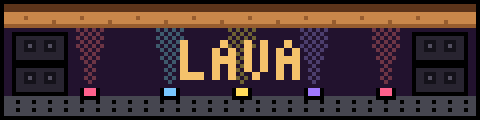
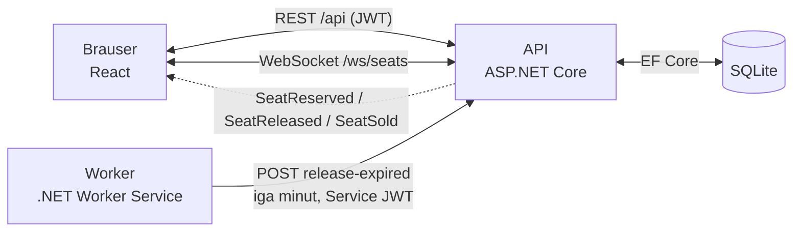
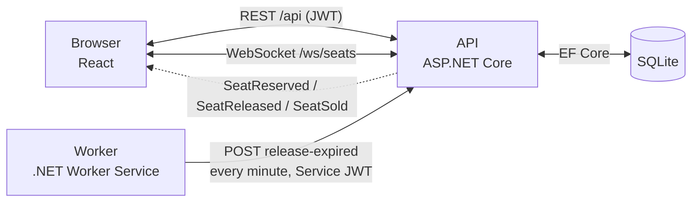

<p align="center">
  
</p>

<p align="center">
  <strong>Piletimüük reaalajas kohavalikuga</strong><br>
  <em>Ticket sales with live seat selection</em>
</p>

<p align="center">
  
  
  
  
  
  
  
  
</p>

<p align="center">
  
</p>

<p align="center"><a href="#eesti">Eesti</a> | <a href="#english">English</a></p>

# Eesti

## &nbsp;Sisukord

- [Mis see on?](#mis-see-on)
- [Kohtade olekud](#kohtade-olekud)
- [Arhitektuur](#arhitektuur)
- [Tehnoloogiad](#tehnoloogiad)
- [Dokumentatsioon](#dokumentatsioon)
- [Nõuded](#nõuded)
- [Käivitamine](#käivitamine)
- [Testkasutajad](#testkasutajad)
- [API otspunktid](#api-otspunktid)
- [WebSocket](#websocket)
- [Testimine](#testimine)
- [Projekti struktuur](#projekti-struktuur)

## &nbsp;Mis see on?

SitSmart on piletimüügi rakendus, kus ostja valib saaliplaanilt koha, hoiab seda 10 minutit[^et-hoid] ja
ostab pileti QR-koodiga. Saaliplaan uueneb reaalajas: kui keegi teine koha broneerib või ostab,
näed seda kohe, ilma lehte uuesti laadimata. Administraator haldab saale ja üritusi ning näeb
müügistatistikat, kontrolör laseb ukse peal piletid sisse. Taustal töötav Worker[^et-worker]
vabastab aegunud broneeringud.

## &nbsp;Kohtade olekud

<table>
  <tr>
    <td align="center"><br>Vaba</td>
    <td align="center"><br>Sinu valik</td>
    <td align="center"><br>Broneeritud (10 min)</td>
    <td align="center"><br>Müüdud</td>
  </tr>
</table>

Igal müüdud kohal istub kass, kokku on kuus eri kassi.[^et-kass]

## &nbsp;Arhitektuur



- **Kontrollerid on õhukesed:** nad kutsuvad teenust ja teisendavad `ServiceResult`-i
  HTTP-vastuseks (404, 400, 409, 403 koos `ProblemDetails`-iga).
- **Äriloogika on teenustes** (`ReservationService`, `PurchaseService`, `CheckInService` jt):
  kontrollid, hinnad, broneeringu aegumine ja topeltmüügi püüdmine unikaalse indeksi kaudu.
- **Teenused teavitavad pärast salvestamist:** kohtade muutus läheb `SeatNotifier`-i kaudu
  WebSocketi gruppi alles siis, kui andmebaas on muudatuse vastu võtnud.

## &nbsp;Tehnoloogiad

<table>
  <tr>
    <th align="left">Backend</th>
    <td>
      
      
    </td>
  </tr>
  <tr>
    <th align="left">Frontend</th>
    <td>
      
      
      
      
      
    </td>
  </tr>
  <tr>
    <th align="left">Andmebaas</th>
    <td>
      
       migratsioonidega
    </td>
  </tr>
  <tr>
    <th align="left">Reaalaeg</th>
    <td>
       <code>/ws/seats</code>, grupid ürituse kaupa
    </td>
  </tr>
  <tr>
    <th align="left">Taustatöö</th>
    <td>
      
    </td>
  </tr>
</table>

## &nbsp;Dokumentatsioon

- [Disainijuhend](docs/design.md): värvid, kirjad, pikslikunst, komponendid ja reeglid

## &nbsp;Nõuded

- [.NET 10 SDK](https://dotnet.microsoft.com/download)
- [Node.js](https://nodejs.org/) LTS
- [PowerShell 7](https://learn.microsoft.com/powershell/scripting/install/installing-powershell) (testi `tests/double-sale.ps1` jaoks)

## &nbsp;Käivitamine

1. **Klooni repo:**

   ```bash
   git clone https://github.com/afunne/SitSmart.git
   cd SitSmart
   ```

2. **Käivita API.** Ühe korra määra vähemalt 32 märgi pikkune JWT-võti:

   ```bash
   cd Piletimyyk.Api
   dotnet user-secrets set "Jwt:Key" "<vähemalt 32 märki>"
   dotnet run --launch-profile http
   ```

   API töötab aadressil http://localhost:5237 ja Swagger aadressil http://localhost:5237/swagger
   (arenduskeskkonnas). Esimesel käivitamisel luuakse andmebaas ja lisatakse näidisandmed: saal,
   kaks üritust ja [testkasutajad](#testkasutajad).

3. **Käivita Worker** teises terminalis, repo juurkaustast. Ühe korra määra Service-kasutaja parool:

   ```bash
   cd Piletimyyk.Worker
   dotnet user-secrets set "Worker:Password" "Service123!"
   dotnet run
   ```

4. **Käivita frontend** kolmandas terminalis, repo juurkaustast:

   ```bash
   cd client
   npm install
   npm run dev
   ```

   Ava http://localhost:5173. Vite suunab `/api` ja `/ws` päringud API-le edasi.

> [!TIP]
> Käivita API enne Workerit. Muidu logib Worker esimesel katsel vea ja proovib alles minuti pärast
> uuesti.

**Tootmisversioon:** `npm run build` kaustas `client` ehitab frontendi kausta
`Piletimyyk.Api/wwwroot`. Siis serveerib API kogu rakendust aadressil http://localhost:5237.

**Visual Studio:** lahenduse menüüst _Configure Startup Projects_ → _Multiple startup projects_ ja
pane nii `Piletimyyk.Api` kui ka `Piletimyyk.Worker` olekusse _Start_. Frontendi käivita ikka
`npm run dev`-iga.

## &nbsp;Testkasutajad

| E-post                | Parool        | Roll                       |
| --------------------- | ------------- | -------------------------- |
| `admin@sitsmart.ee`   | `Admin123!`   | Admin                      |
| `buyer@sitsmart.ee`   | `Buyer123!`   | Buyer                      |
| `buyer2@sitsmart.ee`  | `Buyer123!`   | Buyer                      |
| `control@sitsmart.ee` | `Control123!` | Controller                 |
| `service@sitsmart.ee` | `Service123!` | Service (ainult Workerile) |

> [!WARNING]
> Need on ainult testkontod, mille `DbSeeder` loob arenduse andmebaasi. Ära kasuta neid paroole
> päris keskkonnas.

## &nbsp;API otspunktid

<details>
<summary>Kõik otspunktid (23)</summary>

| Meetod   | Tee                                  | Roll             | Mida teeb                                               |
| -------- | ------------------------------------ | ---------------- | ------------------------------------------------------- |
| `POST`   | `/api/auth/login`                    | kõik             | Sisselogimine, tagastab JWT                             |
| `GET`    | `/api/auth/me`                       | sisse logitud    | Sisse logitud kasutaja e-post ja roll                   |
| `GET`    | `/api/halls`                         | Admin            | Kõik saalid                                             |
| `GET`    | `/api/halls/{id}`                    | Admin            | Üks saal                                                |
| `POST`   | `/api/halls`                         | Admin            | Uus saal, kohad luuakse ridade ja kohtade arvu järgi    |
| `PUT`    | `/api/halls/{id}`                    | Admin            | Saali ümbernimetamine                                   |
| `DELETE` | `/api/halls/{id}`                    | Admin            | Saali kustutamine (409, kui saalis on üritusi)          |
| `GET`    | `/api/events`                        | kõik             | Kõik üritused, eelseisvad enne                          |
| `GET`    | `/api/events/{id}`                   | kõik             | Üks üritus                                              |
| `GET`    | `/api/events/{id}/seats`             | kõik             | Saaliplaan; tokeniga on enda broneeringud olekus "Mine" |
| `POST`   | `/api/events`                        | Admin            | Uus üritus                                              |
| `PUT`    | `/api/events/{id}`                   | Admin            | Ürituse muutmine                                        |
| `DELETE` | `/api/events/{id}`                   | Admin            | Ürituse kustutamine (409, kui pileteid on müüdud)       |
| `POST`   | `/api/events/{eventId}/reservations` | Buyer            | Koha broneerimine (409, kui koht on võetud)             |
| `GET`    | `/api/reservations/my`               | Buyer            | Enda kehtivad broneeringud                              |
| `DELETE` | `/api/reservations/{id}`             | Buyer            | Enda broneeringu tühistamine                            |
| `POST`   | `/api/reservations/{id}/purchase`    | Buyer            | Ostmine: broneeringust saab pilet (409, kui aegunud)    |
| `POST`   | `/api/reservations/release-expired`  | Service          | Aegunud broneeringute vabastamine (Worker)              |
| `GET`    | `/api/events/{id}/stats`             | Admin            | Ühe ürituse statistika                                  |
| `GET`    | `/api/stats/events`                  | Admin            | Kõigi ürituste statistika                               |
| `GET`    | `/api/tickets/my`                    | Buyer            | Enda piletid                                            |
| `GET`    | `/api/tickets/{code}/qr`             | omanik või Admin | Pileti QR-kood (PNG)                                    |
| `POST`   | `/api/tickets/{code}/check-in`       | Controller       | Pileti märkimine kasutatuks (409, kui juba kasutatud)   |

</details>

## &nbsp;WebSocket

Saaliplaan saab kohtade muutused WebSocketi kaudu. Ühenduda saab iga sisse logitud kasutaja; kuna
brauser ei saa WebSocketile päist lisada, käib JWT aadressi sees:

```
ws://localhost:5237/ws/seats?access_token=<JWT>
```

Ürituse jälgimiseks saada pärast ühendumist (korraga saab jälgida ühte üritust, `{"type":"leave"}`
lõpetab):

```json
{ "type": "join", "eventId": 1 }
```

Server lisab ühenduse gruppi `event-{eventId}` ja saadab sinna iga kohamuutuse. `type` on
`SeatReserved`, `SeatReleased` või `SeatSold`:

```json
{ "type": "SeatSold", "eventId": 1, "seatId": 5 }
```

## &nbsp;Testimine

- **`Piletimyyk.Api/Piletimyyk.Api.http`:** kõik otspunktid kõigi rollidega, iga päringu juures
  oodatud vastuse kood. Käivita Visual Studios või VS Code'is REST Client laiendiga.
- **`pwsh tests/double-sale.ps1`:** kaks ostjat proovivad sama kohta korraga broneerida ja osta.
  Oodatud tulemus: üks õnnestub, teine saab 409. Test ostab päriselt ühe pileti.

## &nbsp;Projekti struktuur

```text
SitSmart/
├── Piletimyyk.Api/       ASP.NET Core Web API: kontrollerid, teenused, EF Core, WebSocket
│   └── Piletimyyk.Api.http   kõik otspunktid kõigi rollidega
├── Piletimyyk.Worker/    taustateenus, mis vabastab aegunud broneeringud
├── client/               React + TypeScript + Vite
├── docs/                 disainijuhend
└── tests/                double-sale.ps1
```

[^et-hoid]: Hoidmise aega saab muuta API seadega `Reservations:HoldMinutes` (vaikimisi 10).

[^et-worker]: Worker käib kord minutis, seda saab muuta seadega `Worker:IntervalSeconds`.

[^et-kass]: Kass valitakse koha rea ja numbri järgi, nii et sama koht näitab alati sama kassi.

# English

## &nbsp;Contents

- [What is it?](#what-is-it)
- [Seat states](#seat-states)
- [Architecture](#architecture)
- [Technologies](#technologies)
- [Documentation](#documentation)
- [Requirements](#requirements)
- [Running](#running)
- [Test users](#test-users)
- [API endpoints](#api-endpoints)
- [WebSocket](#websocket-1)
- [Testing](#testing)
- [Project structure](#project-structure)

## &nbsp;What is it?

SitSmart is a ticket sales app where buyers pick a seat on the hall map, hold it for 10 minutes[^en-hold]
and buy a ticket with a QR code. The seat map updates live: when someone else reserves or buys a
seat, you see it right away, without reloading the page. Admins manage halls and events and see
the sales statistics, and controllers check tickets in at the door. A background Worker[^en-worker]
releases expired holds.

## &nbsp;Seat states

<table>
  <tr>
    <td align="center"><br>Free</td>
    <td align="center"><br>Your pick</td>
    <td align="center"><br>Reserved (10 min)</td>
    <td align="center"><br>Sold</td>
  </tr>
</table>

Every sold seat has a cat on it, six different cats in all.[^en-cats]

## &nbsp;Architecture



- **Thin controllers:** they call a service and turn its `ServiceResult` into an HTTP response
  (404, 400, 409, 403 with `ProblemDetails`).
- **The business logic lives in the services** (`ReservationService`, `PurchaseService`,
  `CheckInService` and others): checks, prices, hold expiry, and catching double sales through a
  unique index.
- **Services notify after saving:** a seat change reaches the WebSocket group through
  `SeatNotifier` only once the database has accepted it.

## &nbsp;Technologies

<table>
  <tr>
    <th align="left">Backend</th>
    <td>
      
      
    </td>
  </tr>
  <tr>
    <th align="left">Frontend</th>
    <td>
      
      
      
      
      
    </td>
  </tr>
  <tr>
    <th align="left">Database</th>
    <td>
      
       with migrations
    </td>
  </tr>
  <tr>
    <th align="left">Real time</th>
    <td>
       <code>/ws/seats</code>, one group per event
    </td>
  </tr>
  <tr>
    <th align="left">Background work</th>
    <td>
      
    </td>
  </tr>
</table>

## &nbsp;Documentation

- [Design guide](docs/design.md): colors, type, pixel art, components and rules

## &nbsp;Requirements

- [.NET 10 SDK](https://dotnet.microsoft.com/download)
- [Node.js](https://nodejs.org/) LTS
- [PowerShell 7](https://learn.microsoft.com/powershell/scripting/install/installing-powershell) (for the `tests/double-sale.ps1` test)

## &nbsp;Running

1. **Clone the repo:**

   ```bash
   git clone https://github.com/afunne/SitSmart.git
   cd SitSmart
   ```

2. **Start the API.** Once, set a JWT key of at least 32 characters:

   ```bash
   cd Piletimyyk.Api
   dotnet user-secrets set "Jwt:Key" "<at least 32 characters>"
   dotnet run --launch-profile http
   ```

   The API runs at http://localhost:5237, Swagger at http://localhost:5237/swagger (in the
   Development environment). On the first start it creates the database and adds sample data: a
   hall, two events and the [test users](#test-users).

3. **Start the Worker** in a second terminal, from the repo root. Once, set the Service user's
   password:

   ```bash
   cd Piletimyyk.Worker
   dotnet user-secrets set "Worker:Password" "Service123!"
   dotnet run
   ```

4. **Start the frontend** in a third terminal, from the repo root:

   ```bash
   cd client
   npm install
   npm run dev
   ```

   Open http://localhost:5173. Vite forwards `/api` and `/ws` requests to the API.

> [!TIP]
> Start the API before the Worker. Otherwise the Worker logs an error on its first try and only
> tries again a minute later.

**Production build:** `npm run build` in `client` builds the frontend into
`Piletimyyk.Api/wwwroot`. The API then serves the whole app at http://localhost:5237.

**Visual Studio:** in the solution's _Configure Startup Projects_, choose _Multiple startup
projects_ and set both `Piletimyyk.Api` and `Piletimyyk.Worker` to _Start_. Run the frontend with
`npm run dev` as before.

## &nbsp;Test users

| Email                 | Password      | Role                          |
| --------------------- | ------------- | ----------------------------- |
| `admin@sitsmart.ee`   | `Admin123!`   | Admin                         |
| `buyer@sitsmart.ee`   | `Buyer123!`   | Buyer                         |
| `buyer2@sitsmart.ee`  | `Buyer123!`   | Buyer                         |
| `control@sitsmart.ee` | `Control123!` | Controller                    |
| `service@sitsmart.ee` | `Service123!` | Service (only for the Worker) |

> [!WARNING]
> These are test accounts only, created by `DbSeeder` in the development database. Don't use these
> passwords anywhere real.

## &nbsp;API endpoints

<details>
<summary>All endpoints (23)</summary>

| Method   | Path                                 | Role           | What it does                                                |
| -------- | ------------------------------------ | -------------- | ----------------------------------------------------------- |
| `POST`   | `/api/auth/login`                    | anyone         | Log in, returns a JWT                                       |
| `GET`    | `/api/auth/me`                       | logged in      | The logged-in user's email and role                         |
| `GET`    | `/api/halls`                         | Admin          | All halls                                                   |
| `GET`    | `/api/halls/{id}`                    | Admin          | One hall                                                    |
| `POST`   | `/api/halls`                         | Admin          | New hall; seats are created from the rows and seats per row |
| `PUT`    | `/api/halls/{id}`                    | Admin          | Rename a hall                                               |
| `DELETE` | `/api/halls/{id}`                    | Admin          | Delete a hall (409 if it has events)                        |
| `GET`    | `/api/events`                        | anyone         | All events, upcoming first                                  |
| `GET`    | `/api/events/{id}`                   | anyone         | One event                                                   |
| `GET`    | `/api/events/{id}/seats`             | anyone         | Seat map; with a token, your own holds show as "Mine"       |
| `POST`   | `/api/events`                        | Admin          | New event                                                   |
| `PUT`    | `/api/events/{id}`                   | Admin          | Change an event                                             |
| `DELETE` | `/api/events/{id}`                   | Admin          | Delete an event (409 if tickets are sold)                   |
| `POST`   | `/api/events/{eventId}/reservations` | Buyer          | Hold a seat (409 if the seat is taken)                      |
| `GET`    | `/api/reservations/my`               | Buyer          | Your active holds                                           |
| `DELETE` | `/api/reservations/{id}`             | Buyer          | Cancel one of your holds                                    |
| `POST`   | `/api/reservations/{id}/purchase`    | Buyer          | Buy: the hold becomes a ticket (409 if it has expired)      |
| `POST`   | `/api/reservations/release-expired`  | Service        | Release expired holds (the Worker)                          |
| `GET`    | `/api/events/{id}/stats`             | Admin          | One event's statistics                                      |
| `GET`    | `/api/stats/events`                  | Admin          | Statistics of all events                                    |
| `GET`    | `/api/tickets/my`                    | Buyer          | Your tickets                                                |
| `GET`    | `/api/tickets/{code}/qr`             | owner or Admin | The ticket's QR code (PNG)                                  |
| `POST`   | `/api/tickets/{code}/check-in`       | Controller     | Mark the ticket as used (409 if it already was)             |

</details>

## &nbsp;WebSocket

The seat map gets seat changes over a WebSocket. Any logged-in user can connect; browsers can't add
headers to a WebSocket, so the JWT goes in the URL:

```
ws://localhost:5237/ws/seats?access_token=<JWT>
```

To watch an event, send this after connecting (one event at a time; `{"type":"leave"}` stops):

```json
{ "type": "join", "eventId": 1 }
```

The server adds the connection to the group `event-{eventId}` and sends every seat change there.
`type` is `SeatReserved`, `SeatReleased` or `SeatSold`:

```json
{ "type": "SeatSold", "eventId": 1, "seatId": 5 }
```

## &nbsp;Testing

- **`Piletimyyk.Api/Piletimyyk.Api.http`:** every endpoint with every role, each request with the
  status code it should get. Run it in Visual Studio, or in VS Code with the REST Client extension.
- **`pwsh tests/double-sale.ps1`:** two buyers try to reserve and buy the same seat at the same
  moment. Expected: one succeeds, the other gets 409. The test really buys a ticket.

## &nbsp;Project structure

```text
SitSmart/
├── Piletimyyk.Api/       ASP.NET Core Web API: controllers, services, EF Core, WebSocket
│   └── Piletimyyk.Api.http   every endpoint with every role
├── Piletimyyk.Worker/    background service that releases expired holds
├── client/               React + TypeScript + Vite
├── docs/                 design guide
└── tests/                double-sale.ps1
```

[^en-hold]: The hold time is set with the API setting `Reservations:HoldMinutes` (10 by default).

[^en-worker]: The Worker runs once a minute; change it with `Worker:IntervalSeconds`.

[^en-cats]: The cat is picked from the seat's row and number, so the same seat always shows the same cat.

<p align="center">
  <br>
  Tehtud ja -:3 ga - Hussein Tahmazov, TTHK 2026
</p>
