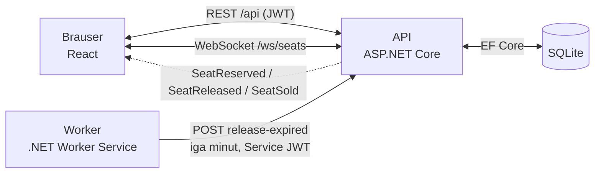
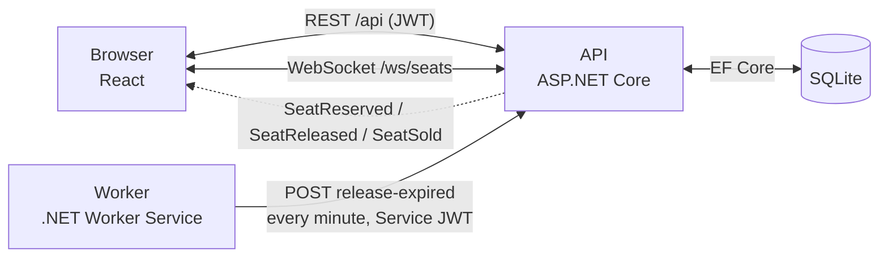

<p align="center">
  
</p>

<p align="center">
  <strong>Piletimüük reaalajas kohavalikuga</strong><br>
  <em>Ticket sales with live seat selection</em>
</p>

<p align="center">
  
  
  
  
  
  
  
  
</p>

<p align="center">
  
</p>

<p align="center"><a href="#eesti">Eesti</a> | <a href="#english">English</a></p>

# Eesti

## &nbsp;Sisukord

- [Mis see on?](#mis-see-on)
- [Kohtade olekud](#kohtade-olekud)
- [Arhitektuur](#arhitektuur)
- [Tehnoloogiad](#tehnoloogiad)
- [Dokumentatsioon](#dokumentatsioon)
- [Käivitamine](#käivitamine)

## &nbsp;Mis see on?

SitSmart on piletimüügi rakendus, kus ostja valib saaliplaanilt koha, hoiab seda 10 minutit[^et-hoid] ja
ostab pileti QR-koodiga. Saaliplaan uueneb reaalajas: kui keegi teine koha broneerib või ostab,
näed seda kohe, ilma lehte uuesti laadimata. Administraator haldab saale ja üritusi ning näeb
müügistatistikat, kontrolör laseb ukse peal piletid sisse. Taustal töötav Worker[^et-worker]
vabastab aegunud broneeringud.

## &nbsp;Kohtade olekud

<table>
  <tr>
    <td align="center"><br>Vaba</td>
    <td align="center"><br>Sinu valik</td>
    <td align="center"><br>Broneeritud (10 min)</td>
    <td align="center"><br>Müüdud</td>
  </tr>
</table>

Igal müüdud kohal istub kass, kokku on kuus eri kassi.[^et-kass]

## &nbsp;Arhitektuur



- **Kontrollerid on õhukesed:** nad kutsuvad teenust ja teisendavad `ServiceResult`-i
  HTTP-vastuseks (404, 400, 409, 403 koos `ProblemDetails`-iga).
- **Äriloogika on teenustes** (`ReservationService`, `PurchaseService`, `CheckInService` jt):
  kontrollid, hinnad, broneeringu aegumine ja topeltmüügi püüdmine unikaalse indeksi kaudu.
- **Teenused teavitavad pärast salvestamist:** kohtade muutus läheb `SeatNotifier`-i kaudu
  WebSocketi gruppi alles siis, kui andmebaas on muudatuse vastu võtnud.

## &nbsp;Tehnoloogiad

<table>
  <tr>
    <th align="left">Backend</th>
    <td>
      
      
    </td>
  </tr>
  <tr>
    <th align="left">Frontend</th>
    <td>
      
      
      
      
      
    </td>
  </tr>
  <tr>
    <th align="left">Andmebaas</th>
    <td>
      
       migratsioonidega
    </td>
  </tr>
  <tr>
    <th align="left">Reaalaeg</th>
    <td>
       <code>/ws/seats</code>, grupid ürituse kaupa
    </td>
  </tr>
  <tr>
    <th align="left">Taustatöö</th>
    <td>
      
    </td>
  </tr>
</table>

## &nbsp;Dokumentatsioon

- [Disainijuhend](docs/design.md): värvid, kirjad, pikslikunst, komponendid ja reeglid

## &nbsp;Käivitamine

API (ühe korra: määra vähemalt 32 märgi pikkune JWT-võti):

```
cd Piletimyyk.Api
dotnet user-secrets set "Jwt:Key" "<random key>"
dotnet run --launch-profile http
```

Frontend teises terminalis (http://localhost:5173, suunab `/api` ja `/ws` API-le edasi):

```
cd client
npm install
npm run dev
```

`npm run build` ehitab frontendi kausta `Piletimyyk.Api/wwwroot`, mida API serveerib aadressil
http://localhost:5237.

[^et-hoid]: Hoidmise aega saab muuta API seadega `Reservations:HoldMinutes` (vaikimisi 10).

[^et-worker]: Worker käib kord minutis, seda saab muuta seadega `Worker:IntervalSeconds`.

[^et-kass]: Kass valitakse koha rea ja numbri järgi, nii et sama koht näitab alati sama kassi.

# English

## &nbsp;Contents

- [What is it?](#what-is-it)
- [Seat states](#seat-states)
- [Architecture](#architecture)
- [Technologies](#technologies)
- [Documentation](#documentation)
- [How to run](#how-to-run)

## &nbsp;What is it?

SitSmart is a ticket sales app where buyers pick a seat on the hall map, hold it for 10 minutes[^en-hold]
and buy a ticket with a QR code. The seat map updates live: when someone else reserves or buys a
seat, you see it right away, without reloading the page. Admins manage halls and events and see
the sales statistics, and controllers check tickets in at the door. A background Worker[^en-worker]
releases expired holds.

## &nbsp;Seat states

<table>
  <tr>
    <td align="center"><br>Free</td>
    <td align="center"><br>Your pick</td>
    <td align="center"><br>Reserved (10 min)</td>
    <td align="center"><br>Sold</td>
  </tr>
</table>

Every sold seat has a cat on it, six different cats in all.[^en-cats]

## &nbsp;Architecture



- **Thin controllers:** they call a service and turn its `ServiceResult` into an HTTP response
  (404, 400, 409, 403 with `ProblemDetails`).
- **The business logic lives in the services** (`ReservationService`, `PurchaseService`,
  `CheckInService` and others): checks, prices, hold expiry, and catching double sales through a
  unique index.
- **Services notify after saving:** a seat change reaches the WebSocket group through
  `SeatNotifier` only once the database has accepted it.

## &nbsp;Technologies

<table>
  <tr>
    <th align="left">Backend</th>
    <td>
      
      
    </td>
  </tr>
  <tr>
    <th align="left">Frontend</th>
    <td>
      
      
      
      
      
    </td>
  </tr>
  <tr>
    <th align="left">Database</th>
    <td>
      
       with migrations
    </td>
  </tr>
  <tr>
    <th align="left">Real time</th>
    <td>
       <code>/ws/seats</code>, one group per event
    </td>
  </tr>
  <tr>
    <th align="left">Background work</th>
    <td>
      
    </td>
  </tr>
</table>

## &nbsp;Documentation

- [Design guide](docs/design.md): colors, type, pixel art, components and rules

## &nbsp;How to run

API (once: set a JWT key of at least 32 characters):

```
cd Piletimyyk.Api
dotnet user-secrets set "Jwt:Key" "<random key>"
dotnet run --launch-profile http
```

Frontend, in a second terminal (http://localhost:5173, forwards `/api` and `/ws` to the API):

```
cd client
npm install
npm run dev
```

`npm run build` builds the frontend into `Piletimyyk.Api/wwwroot`, which the API serves at
http://localhost:5237.

[^en-hold]: The hold time is set with the API setting `Reservations:HoldMinutes` (10 by default).

[^en-worker]: The Worker runs once a minute; change it with `Worker:IntervalSeconds`.

[^en-cats]: The cat is picked from the seat's row and number, so the same seat always shows the same cat.
